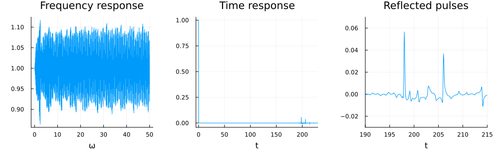

# Time response from a single particle

The code [`time_response_single_particle.jl`](time_response_single_particle.jl) calculates the response, in frequency and in time, from one circular particle which is hit by a plane wave pulse.

The plane wave starts at the origin and travels in the direction of the $x$-axis. The particle has radius 1 and is centred at $x = 100$. The listener is at the origin:

```julia
using MultipleScattering

# Define the particle
radius = 1.0
particle_medium = Acoustic(2; ρ = 10.0, c = 0.5)
particles = [Particle(particle_medium, Sphere([100.0, 0.0], radius))]

# Define the source wave
host_medium = Acoustic(1.0, 1.0, 2)
source = plane_source(host_medium; position = [0.0, 0.0], direction = [1.0, 0.0])
```

Next we calculate the response at the listener for many frequencies. Larger frequencies need a larger basis order, so the basis order increases from `min_basis_order = 1`, for the smallest frequency, up to `basis_order = 14`, for the largest frequency, see [Simulations and results](@ref):

```julia
ωs = LinRange(0.0, 50.0, 2000)
freq_result = run(particles, source, [0.0, 0.0], ωs; min_basis_order = 1, basis_order = 14)
```

To calculate the response in time, we use a Gaussian impulse which is very narrow in time, see [Time response](@ref):

```julia
time_result = frequency_to_time(freq_result; impulse = GaussianImpulse(1.0; σ = 10/maximum(ωs)^2))
```

Finally, we plot the results:

```julia
using Plots

p1 = plot(freq_result, title = "Frequency response")
p2 = plot(time_result, xlims = (-5, 230), title = "Time response")
p3 = plot(time_result, xlims = (190, 215), ylims = (-0.03, 0.07), title = "Reflected pulses")
plot(p1, p2, p3, layout = (1, 3), size = (1000, 300), legend = false)
```


In frequency, the response oscillates around 1, which is the value of the incident plane wave at the origin. In time, the incident pulse is at the listener at time $t = 0$. The pulse then takes the time $t = 99$ to reach the particle, as the sound speed of the host medium is 1, and the same time to come back. This is why the first reflected pulse arrives at $t = 198$. Part of the pulse also travels through the particle, which has sound speed 0.5, and is reflected from the back of the particle. This takes the additional time $2 \times 2 / 0.5 = 8$, which leads to the second reflected pulse at $t = 206$.

!!! note
    The time response is periodic with the period $2\pi / \Delta \omega \approx 251$, where $\Delta \omega$ is the step between the frequencies `ωs`. This is why we only plot up to $t = 230$, see the tip at the end of [Time response](@ref).
