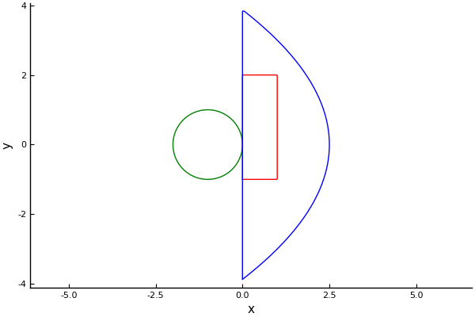

# Shapes

```@meta
DocTestSetup = quote
    using MultipleScattering
end
```
[`Shape`](@ref) is an abstract type which represents the shape of particles, and also the regions where particles are placed or where fields are calculated. See [Shape](@ref base_shapes) for a list of relevant types and functions.

## Existing shapes

| Shape | Description |
|:------|:------------|
| [`Sphere`](@ref) | A circle in 2D and a sphere in 3D. `Circle(radius)` and `Sphere(radius)` are short for a circle or sphere at the origin. |
| [`Box`](@ref) | A rectangle in 2D and a box in 3D, with sides parallel to the axes. `Rectangle(bottomleft, topright)` also creates a 2D box. |
| [`Halfspace`](@ref) | All points behind a plane, defined by its outward normal and a point on the plane. |
| [`Plate`](@ref) | All points between two parallel planes. |
| [`Polygon`](@ref) | A 2D polygon defined by its vertices. |
| [`IsotropicHelmholtz`](@ref), [`Helmholtz`](@ref) | 2D Helmholtz resonators: a circular wall with an opening (aperture). |
| [`TimeOfFlightPlaneWaveToPoint`](@ref), [`TimeOfFlightPointWaveToPoint`](@ref) | Regions which contain all particles that can be reached by a wave, and then scatter back to a listener, within a given time. |
| [`EmptyShape`](@ref) | A shape with no points. |

For example:
```jldoctest shapes
julia> circle = Sphere([-1.0, 0.0], 1.0) # origin and radius
Sphere{Float64, 2}([-1.0, 0.0], 1.0)

julia> rectangle = Box([[0.0, -1.0], [1.0, 2.0]]) # the smallest box which contains these points
Box{Float64, 2}([0.5, 0.5], [1.0, 3.0])

julia> name(circle), name(rectangle)
("Circle", "Rectangle")
```

You can plot shapes by using:
```julia
using Plots;

timeofflight = TimeOfFlightPlaneWaveToPoint([1.0, 0.0], 3.0)

plot(rectangle, linecolor = :red)
plot!(circle, linecolor = :green)
plot!(timeofflight, linecolor = :blue)
```


The `Box` and `TimeOfFlightPlaneWaveToPoint` are usually regions where particles are placed. The time of flight shape contains all particles, from a halfspace, which can be reached by a plane wave and then scatter back to the listener at most a time `t` later. The `Sphere` is also used to define circular or spherical particles.

## Working with shapes

Check if a point is inside a shape, or if a shape is inside another shape:
```jldoctest shapes
julia> [0.5, 0.5] ∈ rectangle
true

julia> Sphere([0.5, 0.5], 0.4) ⊆ rectangle
true

julia> circle ⊆ rectangle
false
```

Calculate the size of shapes:
```jldoctest shapes
julia> volume(rectangle) # the area in 2D
3.0

julia> outer_radius(rectangle) # the radius of the smallest circle, around the origin, which contains the shape
1.5811388300841898

julia> bounding_box(circle) # the smallest box which contains the shape
Box{Float64, 2}([-1.0, 0.0], [2.0, 2.0])
```

Shapes which are the same, except for their origin, are congruent. Particles which are congruent have the same T-matrix, which saves time in simulations.
```jldoctest shapes
julia> circle2 = congruent(circle, [4.0, 4.0]) # the same shape but with origin [4.0, 4.0]
Sphere{Float64, 2}([4.0, 4.0], 1.0)

julia> iscongruent(circle, circle2) # can also be written as circle ≅ circle2
true
```

Other useful functions include [`boundary_points`](@ref), which returns points on the boundary of a shape, and [`points_in_shape`](@ref), which returns a grid of points inside a shape.

## New shapes

To define a new shape see [New particles](@ref).
