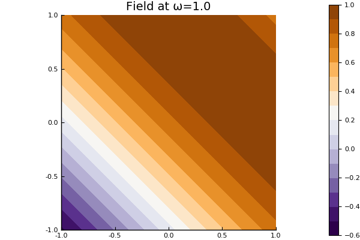
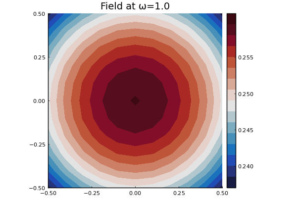
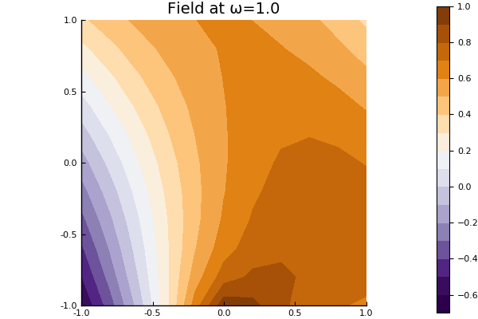
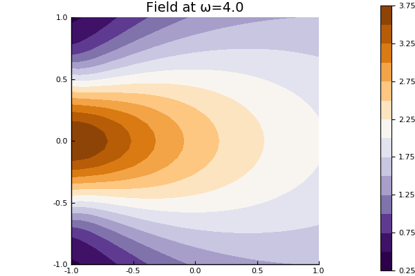

# RegularSources

```@meta
DocTestSetup = quote
    using MultipleScattering
end
```
[`RegularSource`](@ref) is a `struct` which represents any source, also called an incident wave. See [RegularSource](@ref source_base) for a list of relevant types and functions.

## Acoustics

For acoustics, any wave field $u_{\text{in}}(\mathbf x)$ that satisfies $\nabla^2 u_{\text{in}}(\mathbf x) + k^2 u_{\text{in}}(\mathbf x) = 0$, with $k = \dfrac{\omega}{c}$, can be a source.

Two commonly used sources are a plane wave and a point source. These can then be added together to create more complicated sources, like imitating a finite sized transducer / source.

For a plane-wave of the form $u_{\text{in}}(\mathbf x) = A \mathrm e^{\mathrm i k \mathbf n \cdot (\mathbf x - \mathbf x_0)}$, where $A$ is the amplitude, $\mathbf n = (n_1,n_2,n_3)$ is a unit vector which points in the direction of propagation, and $\mathbf x_0 = (x_0,y_0,z_0)$ is the initial position (or origin) of the source, we can use

```jldoctest source
julia> using MultipleScattering;

julia> dimension = 3;

julia> medium = Acoustic(dimension; ρ = 1.0, c = 1.0);

julia> A = 1.0;

julia> n = [1.0, 1.0, 1.0];

julia> x0 = [1.0, 0.0, 0.0];

julia> plane_wave = plane_source(medium; amplitude = A, direction = n, position = x0);

```

The `direction` is normalised to a unit vector. The amplitude `A` can also be a function of the angular frequency `ω`, for example `amplitude = ω -> exp(-ω^2)`. With the keyword `causal = true` the plane wave is zero behind the plane $\mathbf n \cdot (\mathbf x - \mathbf x_0) = 0$, and with `beam_width = w` it is zero at a distance greater than `w/2` from the line which passes through $\mathbf x_0$ in the direction $\mathbf n$.

We can plot this source wave one frequency ω by using
```julia
julia> ω = 1.0;

julia> plot_origin = zeros(3); plot_dimensions = 2 .* ones(3);

julia> plot_domain = Box(plot_origin, plot_dimensions);

julia> using Plots;

julia> plot(plane_wave, ω; region_shape = plot_domain, y = 0.0) # in 3d currently only x-z slices are plotted for a given fixed y
```


Another useful source is the point source. In any dimension we consider the point source to be the zero order of the [`outgoing_basis_function`](@ref), which are the basis for all outgoing waves.

The point source for 2D is $u_{\text{in}}(\mathbf x) = \frac{\mathrm i A}{4} \mathrm H_0^{(1)}(k \|\mathbf x - \mathbf x_0\|)$ and for 3D it is

```math
u_{\text{in}}(\mathbf x) = A \, \mathrm h_0^{(1)}(k \|\mathbf x - \mathbf x_0\|) \mathrm Y_0^0 = - \frac{\mathrm i A}{\sqrt{4 \pi}} \frac{\mathrm e^{\mathrm i k \| \mathbf x - \mathbf x_0\|}}{k \| \mathbf x - \mathbf x_0\|},
```

where $A$ is the amplitude, $\mathbf x_0$ is the origin of the point source, $\mathrm H_0^{(1)}$ is the Hankel function of the first kind, $\mathrm h_0^{(1)}$ is the spherical Hankel function of the first kind, and $\mathrm Y_0^0 = 1 / \sqrt{4 \pi}$ is a spherical harmonic.

```julia
julia> x0 = [0.0,-1.2, 0.0];

julia> point_wave = point_source(medium, x0, A);

```
```julia
julia> plot(point_wave, ω; region_shape = plot_domain)
```


!!! note
    Because the point source has a singularity at $\mathbf x_0$ it is best to avoid plotting, and evaluating the field, close to $\mathbf x_0$. This can be achieved by using `run(point_wave, plot_domain, [ω]; exclude_region = some_region)` or `plot(point_wave, ω; region_shape = plot_domain, exclude_region = some_region)`, both of which rely on the function [`points_in_shape`](@ref).

## Creating new sources

The easiest way to create new sources is to just sum together predefined sources:

```julia
julia> source = (3.0 + 1.0im) * point_wave + plane_wave;

julia> plot(source, ω; bounds = plot_domain)
```


For example, we can use this to create a finite emitter/transducer source,
```julia
julia> xs = LinRange(-0.7, 0.7, 30);

julia> source = sum(xs) do x point_source(medium, [x, 0.0, -1.1]) end;

```
```julia
julia> plot(source, 4.0; y = 0.0, bounds = plot_domain, field_apply = abs, resolution = 40)
```


where `field_apply` is applied to the wave field at every point, the default is `field_apply = real`, and `resolution` is the resolution along both the $x$ and $y$ axis. Note, this is not computationally very efficient. See [source.jl](https://github.com/JuliaWaveScattering/MultipleScattering.jl/blob/master/src/source.jl) for the very abstract code behind the scenes.

A source can also be defined from its coefficients in the regular basis, explained below, by using [`regular_spherical_source`](@ref).

To define a new source you will need to understand the internals below.

## RegularSource internals

The `struct` [`RegularSource`](@ref) has three fields: `medium`, `field`, and `coefficients`, explained with examples below:

```jldoctest source
julia> plane_wave = plane_source(Acoustic(1.0, 1.0, 2); direction = [1.0,0.0]);

julia> plane_wave.medium # the physical medium
Acoustic(1.0, 1.0 + 0.0im, 2)

julia> x = [1.0, 1.0]; ω = 1.0;

julia> plane_wave.field(x,ω) # the value of the field
0.5403023058681398 + 0.8414709848078965im
```

To calculate the scattering from a particle due to a source, we need to represent the source in a radial coordinate system. That is, for any origin $\mathbf x_0$, we need to represent the incident wave $u_{\text{in}}(\mathbf x)$ using a series of regular waves

```math
u_{\text{in}}(\mathbf x) = \sum_n a_n (\mathbf x_0, \omega) \mathrm v_n (\mathbf x - \mathbf x_0),
```

where for the scalar wave equation:

```math
\mathrm v_{n} (\mathbf x) = \begin{cases}
   \mathrm J_{n}(k r) \mathrm e^{\mathrm i \theta n} & \text{for } \mathbf x \in \mathbb R^2, \\
   \mathrm j_{\ell}(k r) \mathrm Y_{\ell}^m (\hat{\mathbf x}) & \text{for } \mathbf x \in \mathbb R^3, \\
\end{cases}
```

where for the first case $(r,\theta)$ are the polar coordinates and $n$ sums over $-N,-N+1, \cdots, N$, where $N$ is the basis order, and $\mathrm J_n$ is a Bessel function.
For the second case, we use spherical coordinates with $r = \| \mathbf x\|$ and $\hat{\mathbf x} = \mathbf x/\|\mathbf x\|$, $n$ denotes the multi-index $n=\{\ell,m\}$ with summation over $\ell = 0, 1, \cdots,N$ and $m=-\ell,-\ell+1,\cdots,\ell$, $\mathrm j_\ell$ is a spherical Bessel function, and $\mathrm Y_\ell^m$ is a spherical harmonic.

The vector of all the coefficients $a_n(\mathbf x_0, \omega)$, up to the basis order $N$, is given by `source.coefficients(N, x0, ω)`. The function [`regular_basis_function`](@ref) returns the row vector of all the $\mathrm v_n(\mathbf x - \mathbf x_0)$, so the series above is a matrix product. For example, for the inbuilt plane wave:
```jldoctest source
julia> medium = Acoustic(2.0, 0.1, 2);

julia> source = plane_source(medium);

julia> x0 = [1.0, 1.0]; ω = 0.9;

julia> x = x0 + [0.05, -0.03]; basis_order = 10;

julia> vs = regular_basis_function(medium, ω);

julia> source.field(x, ω) ≈ (vs(basis_order, x - x0) * source.coefficients(basis_order, x0, ω))[1]
true
```

The package also supplies a convenience function [`source_expand`](@ref), which represents the source in terms of regular waves, for example:
```jldoctest source
julia> source2 = source_expand(source, x0; basis_order = 10);

julia> source.field(x, ω) ≈ source2(x, ω)
true
```

To create a new source, you need to provide both functions `field(x, ω)` and `coefficients(N, x0, ω)` to the constructor `RegularSource(medium, field, coefficients)`.
